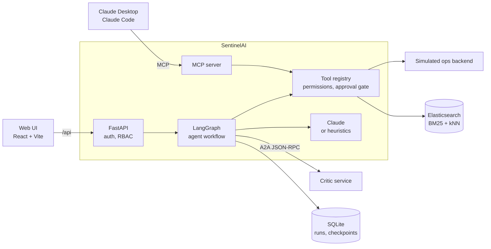
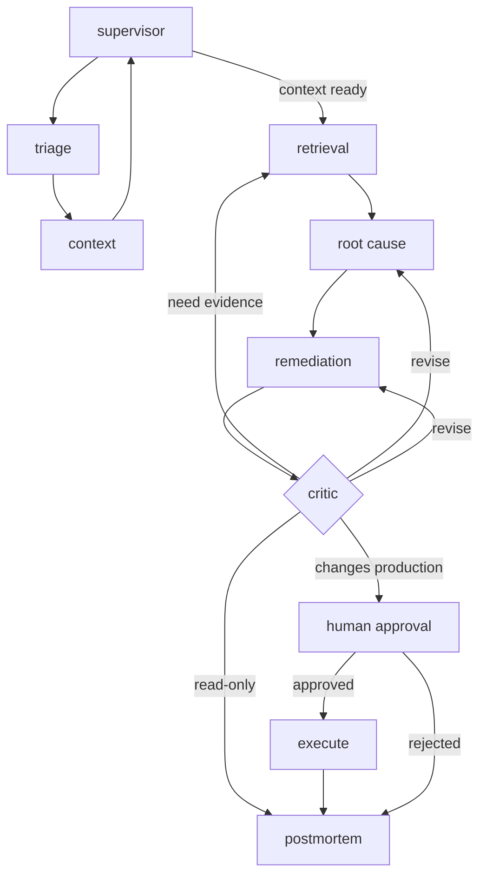

# SentinelAI

Multi-agent incident response for SRE teams. Changes to production need human approval.

[](https://github.com/gagan-rohith/sentinel-ai/actions/workflows/lint.yml)
[](https://github.com/gagan-rohith/sentinel-ai/actions/workflows/test.yml)
[](https://github.com/gagan-rohith/sentinel-ai/actions/workflows/docker.yml)
[](LICENSE)

When an alert fires, a team of specialist agents gathers the logs, metrics and deploy history,
searches runbooks and past incidents, ranks root causes against the evidence and drafts a fix.
Every claim cites evidence that is checked in code. Anything that would change production
stops and waits for an admin to approve it.

- Live demo: https://gagan-rohith.github.io/sentinel-ai/ (a replay of recorded runs)
- New here? [SentinelAI, explained simply](docs/INTRODUCTION.md)
- Demo video: coming soon


## Key points

- On the holdout benchmark, where every past incident of the same failure type is hidden, the
  Claude agents pick the right runbook 90% of the time. The offline heuristic baseline gets
  41.7%. Details in [docs/EVALUATION.md](docs/EVALUATION.md).
- Hybrid search (BM25 and dense vectors fused with RRF on Elasticsearch) ranks the right
  runbook first for 91.7% of paraphrased questions, against 71.4% for BM25 and 79.8% for
  vectors alone.
- Every piece of evidence gets an id. The critic agent rejects plans that cite ids that do not
  exist or that contradict their own evidence, and this check is code, not a model.
- Restarts and rollbacks pause the run with LangGraph `interrupt()`. Approval needs the admin
  role and works once, and a paused run survives an API restart.
- The same tools are served over MCP to Claude Desktop and Claude Code. The critic runs as a
  separate [A2A service](docs/A2A.md).
- Without `ANTHROPIC_API_KEY` the agents use deterministic heuristics over the same evidence,
  so the system and its tests run offline.

## A run, step by step

The demo incident is INC-1060: `checkout-api` starts returning 500s during a flash sale.
Traffic is 2.5x normal, p99 latency is 4.7 s, and a deploy went out three hours earlier.

| Step | Agent | What happens |
|---|---|---|
| 1 | Triage | Classifies it as a sev1 database problem. |
| 2 | Context | Calls the ops tools in parallel. Logs show `HikariPool-1 - Connection is not available`, pool `active=100, idle=0, waiting=412`. |
| 3 | Retrieval | Hybrid search over runbooks, similar incidents and service docs. |
| 4 | Root cause | PostgreSQL connection pool exhaustion wins, with cited evidence. The deploy is ruled out because errors did not start within 30 minutes of it. |
| 5 | Remediation | Turns the runbook into steps: confirm saturation, shed traffic, add PgBouncer, rolling restart. |
| 6 | Critic | Checks citations, contradictions and tool calls. Can send work back up to three times. |
| 7 | Human approval | The restart changes production, so the run pauses. An operator key gets 403; an admin approves. |
| 8 | Execute and postmortem | The restart runs against a simulated cluster and the postmortem is written from real timestamps. |

| Approval gate | Report |
|---|---|
|  |  |

The live demo is the real web UI in replay mode: every run on it was recorded from the real
system with `make record-demo`, so it needs no server.

## Architecture





The tool registry is the only path to a tool, for the agents, the REST API and the MCP server
alike, so permission checks and the approval gate cannot be skipped. Whether an action is
destructive comes from the registry, never from the model. Design decisions and trade-offs are
in [ARCHITECTURE.md](ARCHITECTURE.md).

| Area | Stack |
|---|---|
| Backend | Python 3.11, FastAPI, Pydantic v2, structlog |
| Agents | LangGraph 1.x, Anthropic SDK (Claude), deterministic fallback |
| Retrieval | Elasticsearch 8.15, BM25 + all-MiniLM-L6-v2 vectors, reciprocal rank fusion |
| Protocols | MCP (stdio and streamable HTTP), A2A (`a2a-sdk` 1.x) |
| Storage | SQLite for incidents, runs, approvals and graph checkpoints |
| Frontend | React 19, TypeScript, Vite |
| Observability | Prometheus, OpenTelemetry (Jaeger), trace ids, optional LangSmith |
| Delivery | Docker Compose, Kubernetes, Terraform (AWS ECS Fargate), GitHub Actions |

## Quick start

**Try it in a terminal, no Docker needed:**

```bash
git clone https://github.com/gagan-rohith/sentinel-ai.git
cd sentinel-ai
pip install torch --index-url https://download.pytorch.org/whl/cpu
pip install -e ".[ml]"
make demo ARGS=--memory               # or: python -m app.demo --memory
```

**Run the full system with Docker** (Docker Desktop, plus Python 3.11 to generate keys):

```bash
cp .env.example .env
python -m auth.api_keys operator     # prints a key and a config line
python -m auth.api_keys admin
python -m critic_service.keys        # key pair for the critic service
```

Put both `config:` lines in `API_KEYS` in `.env`, comma separated
(`API_KEYS=operator:<hash>,admin:<hash>`), and keep the two `key:` values safe, since only
their hashes are stored. Copy the two `CRITIC_API_KEY...` lines into `.env` as printed. Then:

```bash
docker compose --profile frontend up --build
```

The first build takes several minutes (CPU PyTorch and the embedding model are baked in).
Then open the web UI at http://localhost:3000 (paste the operator key; switch to the admin key
to approve) and the API docs at http://localhost:8000/docs. Set `ANTHROPIC_API_KEY` in `.env`
to have Claude do the reasoning.

## Development

```bash
python -m venv .venv
.venv\Scripts\activate                # macOS or Linux: source .venv/bin/activate
pip install torch --index-url https://download.pytorch.org/whl/cpu
pip install -e ".[dev,ml]"

docker compose up -d elasticsearch     # or set SEARCH_BACKEND=memory in .env
make index && make run                 # API on :8000 with reload
cd frontend && npm ci && npm run dev   # UI on :5173
```

| Command | What it does |
|---|---|
| `make check` | ruff, mypy (strict) and the tests with coverage |
| `make demo` | terminal walkthrough of INC-1060 |
| `make bench` | run the benchmark into `evals/reports/` |
| `make data` | regenerate the synthetic incidents, logs, metrics and runbooks |

Tests use in-memory search and a hash embedder, so they need neither Docker nor model
downloads. CI also runs them against a real Elasticsearch.

## Security

- API keys have roles: `viewer` reads, `operator` analyzes and rejects, `admin` also
  approves production changes. Only SHA-256 hashes are stored.
- Nothing destructive runs automatically. Only the exact actions in an approved plan can run,
  once. Over MCP, `restart_service` and `rollback_deployment` need an admin key and an
  approval id, so an assistant can investigate but not act on its own.
- Secrets stay out of the repo: `.env` is ignored, Kubernetes reads a Secret created at
  deploy time, and Terraform creates its secret without a value, so none lands in state.

## Limitations

- Logs, metrics, deploys and Kubernetes actions come from a seeded simulator, not a real
  cluster.
- The 60 incidents are synthetic: enough to compare methods, not to predict real accuracy.
- Claude was benchmarked once, on one model at its default effort.
- SQLite means one API instance per database; scaling out needs PostgreSQL.
- The web UI polls for progress instead of streaming it.

Next up: real telemetry connectors (Prometheus, Loki, Kubernetes), PostgreSQL checkpoints,
streamed progress, Slack or PagerDuty approvals, and a less templated dataset.

## Documentation

| Doc | Covers |
|---|---|
| [Introduction](docs/INTRODUCTION.md) | The idea in plain language |
| [Architecture](ARCHITECTURE.md) | Design decisions and trade-offs |
| [Evaluation](docs/EVALUATION.md) | Dataset, settings, full results and how to read them |
| [REST API](docs/API.md) | Endpoints and a full run with curl |
| [MCP server](docs/MCP.md) | Tools and setup for Claude Desktop and Claude Code |
| [A2A critic](docs/A2A.md) | Why the critic is its own service and how the hop works |
| [Deployment](docs/DEPLOYMENT.md) | Compose, Kubernetes, Terraform, CI and observability |
| [Demo guide](docs/DEMO.md) | The web UI, the terminal and Claude Desktop |

## Project layout

```
agents/          agent nodes, prompts, heuristics, evidence catalog
app/             FastAPI app, routes, terminal demo
auth/            API keys, roles, permissions
core/            domain models, enums, typed errors
critic_service/  the critic as an A2A service and its client
data/            synthetic data generator, incidents, logs, runbooks
evals/           benchmark, evaluators, datasets, reports
graph/           LangGraph state, routing, checkpointer, run manager
mcp_server/      MCP server over the tool registry
observability/   logging, metrics, tracing
retrieval/       Elasticsearch and in-memory backends, hybrid search
storage/         SQLite repositories
tools/           ops tools and the tool registry
frontend/        React web UI
docker/ k8s/ terraform/ .github/   deployment and CI
```

## License

[MIT](LICENSE), copyright (c) 2026 Gagan Rohit.
